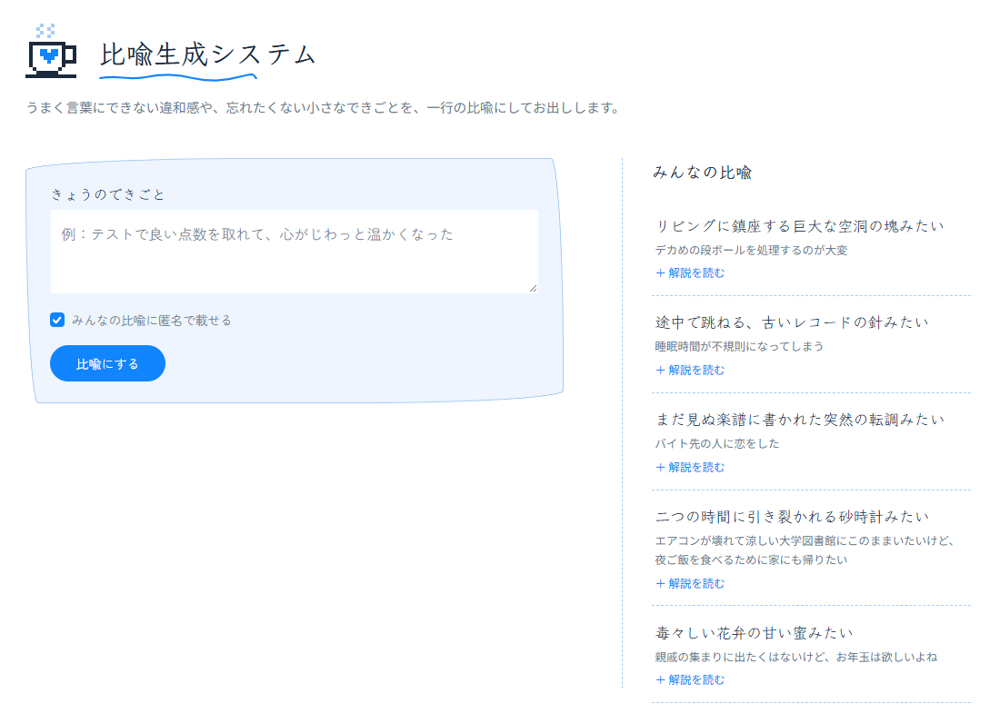
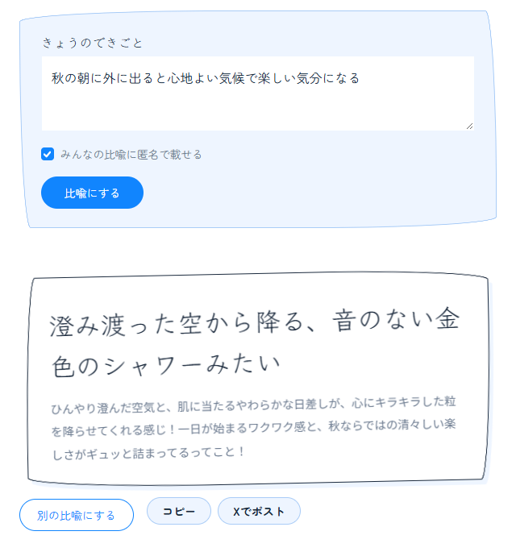
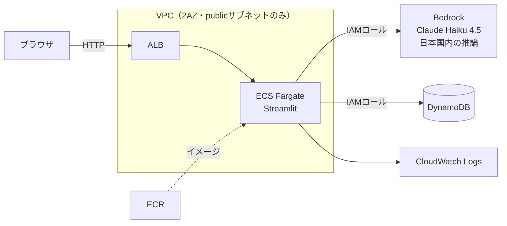

# 比喩生成システム

うまく言葉にできない違和感や、忘れたくない小さなできごとを、一行の比喩にするWebアプリです。
AWS（ECS on Fargate）で動かし、インフラはすべて Terraform で管理しています。

> コストを抑えるため、普段は環境を停止しています。Terraform で数分あれば同じ環境を作り直せます。




## できること

- できごとや気持ちを入力すると、一行の比喩と、その比喩になった理由の解説が返ってきます
- 気に入らなければ「別の比喩にする」で、前とは違う発想の比喩を出し直せます
- 比喩はコピーしたり、Xにポストしたりできます
- 「みんなの比喩」に匿名で載せて、ほかの人の比喩と解説を読めます

## 構成



| 役割 | 使っているもの |
|---|---|
| 画面 | Streamlit（カスタムCSS） |
| 比喩の生成 | Amazon Bedrock（Claude Haiku 4.5、jp 推論プロファイル） |
| データベース | DynamoDB（オンデマンド） |
| 実行環境 | ECS on Fargate、ALB、VPC、ECR |
| インフラ管理 | Terraform（常時残す層と、使うときだけ立てる層の2つ） |

Terraform は2つに分けています。

| 層 | 中身 | 方針 |
|---|---|---|
| `infra/base` | DynamoDB、ECR、CloudWatch Logs | 常時残す。ほぼ無料。DynamoDB は削除保護＋`prevent_destroy` |
| `infra/app` | VPC、ALB、ECS、IAMロール | 使うときだけ `apply`、終わったら `destroy` |

## 設計で気をつけたこと

**なぜ ECS on Fargate か**
- Streamlit は常駐するプロセスで、ブラウザと WebSocket でつながり続けます。リクエストごとに起動する Lambda には向かないため、コンテナを常駐させる ECS を選びました
- EC2 と違い OS の管理が要らない Fargate にしました

**秘密情報を持たない**
- 以前は Gemini の APIキーと Supabase のキーを管理していましたが、生成を Bedrock、保存を DynamoDB に移し、どちらも ECS タスクの IAM ロールで認証するようにしました。アプリが持つ APIキーやパスワードはありません
- IAM は「使う操作」と「使うリソース」の両方を絞っています。DynamoDB は Query・PutItem・DeleteItem をこのテーブルだけに、Bedrock は jp 推論プロファイル経由の呼び出しだけに限定しています（推論を日本国内に限定）
- 実行ロール（イメージの取得・ログ）とタスクロール（アプリが使う権限）を分けています

**コストを抑える**
- 時間課金のもの（ALB・Fargate）は `infra/app` にまとめ、使うときだけ立てます。データは `infra/base` にあるので、`destroy` しても消えません
- NAT Gateway は常時課金で高いため置いていません。本来はタスクを private サブネットに置きますが、ここでは public サブネットに置き、セキュリティグループで「ALB からの 8501 番だけ」を受け付けるようにしています。出ていく通信も HTTPS だけです
- Fargate は最小サイズ（0.25 vCPU / 0.5 GB）、Container Insights は無効です

**公開サービスとしての安全性**
- 自分の投稿を消せるように、投稿時にランダムな合言葉を発行し、DB にはそのハッシュだけを保存しています。削除は DynamoDB の条件付き削除で行い、照合と削除を1回の操作で済ませています
- 入力や生成結果は、画面に出す前にすべて HTML エスケープしています
- 生成は1人10秒おき・1回の訪問で30回まで、サイト全体で1分8回までに制限しています

**止まりにくくする**
- Bedrock の一時的なエラーは boto3 が自動で再試行します（最大3回）。外部通信には短めのタイムアウトを設定しています
- エラーは原因ごと（上限・混雑・設定の問題）に、次に何をすればいいかが分かる文言で表示します
- ALB は Streamlit 組み込みの `/_stcore/health` でヘルスチェックし、新しいイメージが起動しなければ ECS が自動で前のバージョンに戻します（デプロイのサーキットブレーカー）
- ライブラリのバージョンを固定し、ECR のタグは上書き禁止にしています

## 動かし方

前提：AWS CLI、Terraform、Docker。Bedrock で Claude Haiku 4.5 のモデルアクセスを有効にしておきます。

**1. 常時残す層を作る（最初の1回だけ）**

```bash
terraform -chdir=infra/base init
terraform -chdir=infra/base apply
```

**2. イメージを作って ECR に push する**

```bash
REPO=$(terraform -chdir=infra/base output -raw ecr_repository_url)
TAG=$(git rev-parse --short HEAD)
aws ecr get-login-password --region ap-northeast-1 | docker login --username AWS --password-stdin "${REPO%%/*}"
docker build --platform linux/amd64 --provenance=false -t "$REPO:$TAG" .
docker push "$REPO:$TAG"
```

**3. アプリを立てる**

```bash
terraform -chdir=infra/app init
terraform -chdir=infra/app apply -var "image_tag=$TAG"
# 確認中は自分のIPだけに絞ると安心： -var "allowed_cidr=$(curl -s https://checkip.amazonaws.com)/32"
```

出力された `app_url` をブラウザで開きます（起動まで1〜2分かかります）。

**4. 使い終わったら消す**

```bash
terraform -chdir=infra/app destroy -var "image_tag=$TAG"
```

### ローカルで動かす

AWS の認証情報（`aws configure` など）がある状態で、次を実行します。

```bash
pip install -r requirements.txt
export TABLE_NAME=metaphor-generator-timeline
streamlit run app.py
```

| 環境変数 | 内容 | 既定 |
|---|---|---|
| `TABLE_NAME` | DynamoDB のテーブル名 | `metaphor-generator-timeline` |
| `BEDROCK_MODEL_ID` | 使うモデル（推論プロファイル） | `jp.anthropic.claude-haiku-4-5-20251001-v1:0` |
| `AWS_REGION` | リージョン | `ap-northeast-1` |
| `APP_URL` | Xの共有文に入れるURL | なし |
| `NG_WORDS` | 弾く言葉（1行に1語） | なし |

### テスト

DynamoDB は moto、Bedrock は boto3 のスタブで置き換えて動かします（AWS には接続しません）。

```bash
pip install -r requirements.txt pytest "moto[dynamodb]"
pytest -q
```

## 変更履歴

- v1：Streamlit Community Cloud ＋ Gemini API ＋ Supabase
- v2：AWS に移行（ECS on Fargate・ALB・VPC・Bedrock・DynamoDB・Terraform）。APIキーをなくし、IAM ロールだけで動く構成に

## ライセンス

[MIT](LICENSE)
